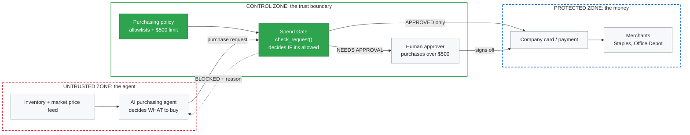
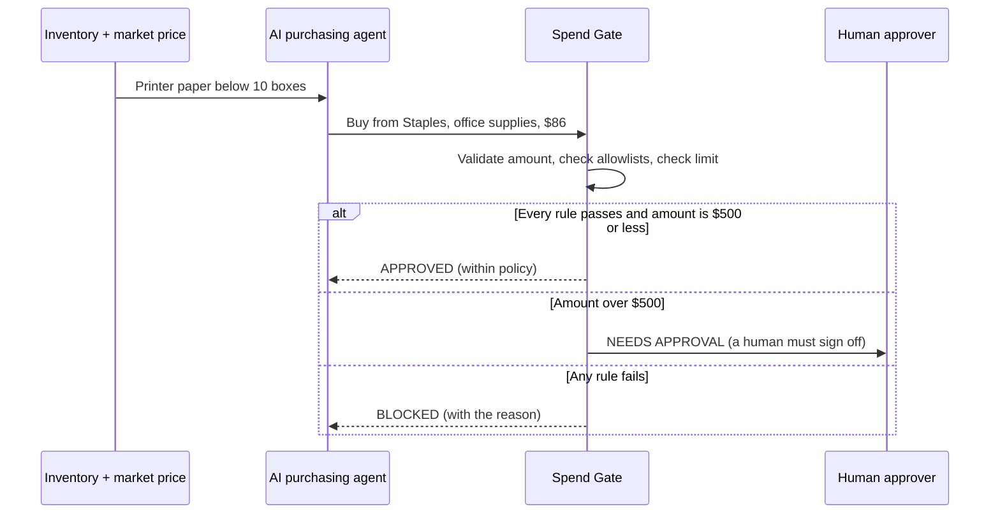
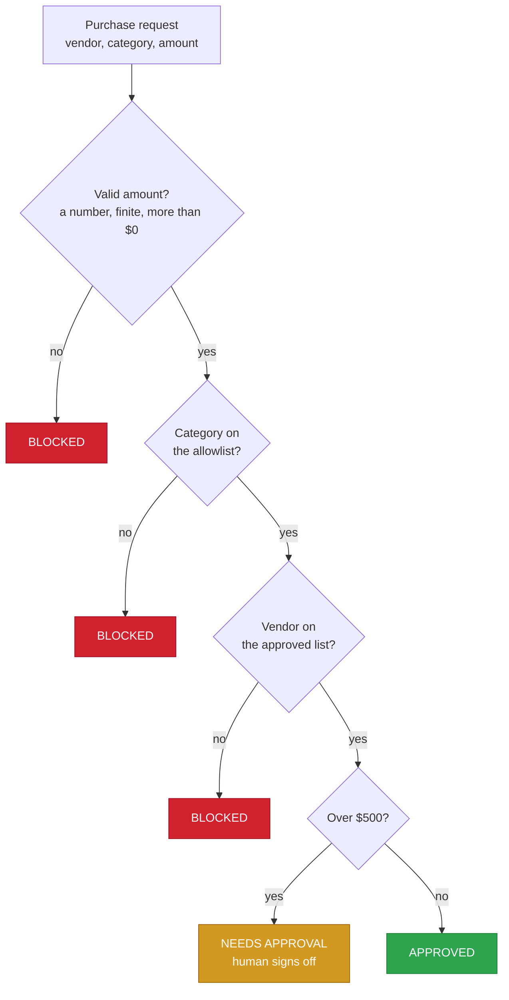

<h1 align="center">AI Agent Spend Gate</h1>

<p align="center">
  <strong>Policy enforcement for AI agents that spend money.</strong><br/>
  The agent decides what to buy. The gate decides whether it's allowed.
</p>

<p align="center">
  
  
  
  
</p>

<p align="center">
  <a href="#the-problem">The problem</a> ·
  <a href="#how-it-works">How it works</a> ·
  <a href="#what-it-stops">What it stops</a> ·
  <a href="#quick-start">Quick start</a> ·
  <a href="#based-on-american-express-ace">Based on ACE</a> ·
  <a href="#design-decisions">Design decisions</a> ·
  <a href="#reference-architecture-on-aws">AWS architecture</a>
</p>

<!--
Demo GIF goes here once it's recorded. Save it as assets/demo.gif, then
replace this comment with:

<p align="center">
  
</p>
-->

> [!NOTE]
> Independent concept project. It is not affiliated with, built for, or endorsed by American Express or any other company. It doesn't use any American Express APIs, code or card data, and no real purchases are made.

---

## The problem

Companies are starting to let AI agents automate purchasing. An agent watches inventory levels and current market prices, and when stock runs low or a price is right, it asks to buy.

For example: printer paper drops below 10 boxes, so the agent requests 5 more from Staples at today's price.

An agent that can spend money needs the same controls a person would have: limited permissions, approval for large purchases, and a clear reason for every decision.

> [!IMPORTANT]
> The agent decides **what** to buy. It must never also decide whether it's **allowed** to. That's separation of duties, and this project is the separate gate.

---

## How it works

### Where the gate sits

The agent works in an untrusted zone. The money is in a protected zone. The gate sits on the trust boundary between them, and it's the only path from one to the other.



🟩 **Green:** built in this repo · ⬜ **Gray:** systems in the environment around it

### The request flow



### The decision: deny by default

Every request goes through one function, `check_request()`. Every rule that can block runs **before** anything that can approve, so the only way to reach `APPROVED` is to pass every check.



<details>
<summary><strong>Rules in order</strong></summary>

<br/>

| Order | Rule | If it fails |
|:---:|:---|:---|
| 0a | Amount must be a number | **BLOCKED** |
| 0b | Amount must be a real, finite number (not NaN or infinity) | **BLOCKED** |
| 0c | Amount must be more than $0 | **BLOCKED** |
| 1 | Category must be on the allowlist | **BLOCKED** |
| 2 | Vendor must be on the approved list | **BLOCKED** |
| 3 | Amount over $500 | **NEEDS APPROVAL** |
| 4 | All checks passed | **APPROVED** |

</details>

---

## What it stops

| Attempt | Result | Control |
|:---|:---:|:---|
| Buying gift cards or other unapproved categories | 🔴 BLOCKED | Category allowlist |
| Buying from an unknown vendor | 🔴 BLOCKED | Vendor allowlist |
| Look-alike vendor names (`staples`) | 🔴 BLOCKED | Exact matching, fails closed |
| Zero or negative amounts | 🔴 BLOCKED | Input validation |
| Text instead of a number (`"86"`, `abc`) | 🔴 BLOCKED | Input validation, instead of crashing |
| `nan` or `inf` as the amount | 🔴 BLOCKED | Input validation (NaN would otherwise be approved) |
| A large purchase with no human involved | 🟡 NEEDS APPROVAL | Four-eyes approval |

### What it doesn't do (yet)

- The purchasing agent itself isn't included. There's no inventory or price monitoring; requests are typed in or come from the demo.
- The policy is written in the code, not loaded from a file.
- No running budget, so many small approved purchases can add up.
- No agent identity or owner, so it can't block agents whose owner has left.
- Decisions are printed, not saved to an audit log.

---

## Quick start

Requires Python 3. No extra packages.

```powershell
git clone https://github.com/saintvisionary/AI-Agent-Spend-Gate.git
cd AI-Agent-Spend-Gate
python guard.py
```

Type a purchase request one field at a time. Type `demo` at the Vendor prompt to run the sample requests, or `quit` to exit.

```
AI Agent Spend Gate
Enter a purchase request. Type 'demo' for sample requests or 'quit' to exit.

Vendor: Staples
Category: office supplies
Amount: $1200
NEEDS APPROVAL Staples $1200: over $500, a human must approve

Vendor: Staples
Category: office supplies
Amount: nan
BLOCKED Staples 'nan': amount must be a real number

Vendor: quit
Goodbye.
```

> [!TIP]
> Typed amounts can include a leading `$` and spaces. The input code only converts text to a number; it never makes a decision. Anything it can't convert goes to `check_request()` unchanged and is blocked there.

<details>
<summary><strong>Full demo output</strong></summary>

<br/>

```
APPROVED Staples $86: within policy
NEEDS APPROVAL Staples $900: over $500, a human must approve
BLOCKED Staples $200: category 'gift cards' is not allowed
BLOCKED Shady Deals LLC $50: vendor 'Shady Deals LLC' is not approved
BLOCKED staples $50: vendor 'staples' is not approved
APPROVED Staples $500: within policy
NEEDS APPROVAL Staples $500.01: over $500, a human must approve
BLOCKED Staples $0: amount must be more than $0
BLOCKED Staples -$5: amount must be more than $0
BLOCKED Staples '86': amount must be a number
BLOCKED Staples 'nan': amount must be a real number
```

</details>

---

## Based on American Express ACE

This project is modeled on concepts American Express has publicly described for its **Agentic Commerce Experiences (ACE) Developer Kit**, which brings card credentials, tokenization and passkey authentication into AI-agent purchase workflows.

In ACE's public description, agents are registered to the network, and each purchase carries a structured **intent**: what the Card Member wants to buy, with controls such as budget limits, item specifications and merchant preferences. The Card Member authorizes the intent, and risk signals and context feed the authorization decision.

This project applies the same idea to a business. The intent comes from a company's purchasing agent restocking inventory, and the controls come from the company's purchasing policy. It builds a simplified version of the decision side of that flow:

| ACE concept (public description) | In this project |
|:---|:---|
| Purchase intent with controls (budget limits, merchant preferences) | Each request has a vendor, category and amount, checked against vendor and category allowlists |
| Spend controls set by the Card Member | Spend controls set by the company: anything over $500 needs a human to approve |
| Explicit authorization of the intent | `NEEDS APPROVAL` sends large purchases to a human (no cryptographic consent in this version) |
| Risk signals that inform the authorization decision | `check_request()` makes a rules-based decision and returns the reason |

---

## Design decisions

| Decision | Why |
|:---|:---|
| Block rules run before approve rules | A $900 gift card request is blocked outright, never sent to a human who might approve it |
| Exact vendor matching | An unexpected value is denied, never allowed (fail closed) |
| Deciding and printing are separate functions | The same decision can be reused, such as for logging, without touching the rules |
| Input code never decides | `parse_amount()` only converts text; there's one decision point |

Problems I hit while building this, and how I fixed them, are in **[JOURNAL.md](JOURNAL.md)**.

---

## Reference architecture on AWS

How the gate would run in production. A scheduled Lambda agent checks inventory and market prices, then drops a purchase intent on an SQS queue. The Spend Gate runs on ECS Fargate in a private subnet, loads its policy from S3, and is the only component allowed to read the payment credential. Large purchases go through a Step Functions approval workflow, where a human signs in with MFA. Every decision streams through CloudWatch and Firehose to Splunk.

<p align="center">
  
</p>

> [!NOTE]
> The decision logic (`guard.py`) is built in this repo. The AWS services show the environment it's designed for. The key control: the agent's IAM role can only send to the queue, so even a compromised agent has no path to the money except through the gate.

---

## Tech stack

| Tool | Use | Control it shows |
|:---|:---|:---|
| **Python 3** (standard library only) | `check_request()` rules engine | Deterministic policy enforcement, deny by default |
| **Git + GitHub** | Version history | Change tracking |

## Project files

| File | What it is |
|:---|:---|
| [`guard.py`](guard.py) | The rules engine, interactive prompt and demo requests |
| [`JOURNAL.md`](JOURNAL.md) | Problems and fixes, and design decisions |
| [`assets/architecture.drawio`](assets/architecture.drawio) | Editable source of the AWS architecture diagram (open in draw.io) |
